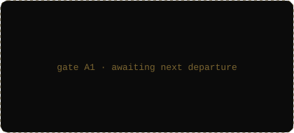

<!--
  Aviation profile README. All numbers are refreshed daily by .github/workflows/profile.yml.
  Only thing to edit by hand: YOUR_X_HANDLE below (or delete that badge).
-->

  

  

  
  

  

  
  

  

